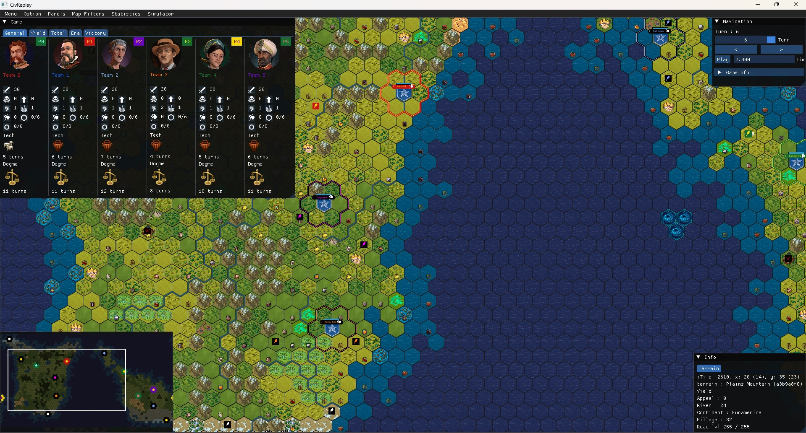

# CivVIReplay

CivVIReplay is a modern C++ application designed to parse and visualize **Civilization VI multiplayer replay data**.
It reconstructs game state information from replay files and presents it through a real-time graphical interface powered by OpenGL and ImGui.

This tool is specifically designed for the competitive multiplayer scene and relies on commonly used multiplayer balance and gameplay mods such as **BBG (Better Balanced Game)**, **BBS (Better Balanced Starts)**, and **MPH (Multiplayer Helper)**. Replays generated without these mods may not be fully supported.

CivVIReplay is built with the multiplayer community in mind, aiming to provide better analytical tools for competitive matches, tournaments, and post-game review.

If you are interested in Civilization VI multiplayer, you can explore community hubs such as:

- **CivFR** (French multiplayer community)
- **CPL (Civilization Players League)** — one of the largest international competitive communities

The project was developed as both a practical tool for the multiplayer ecosystem and a technical exploration of binary parsing, structured data modeling, and rendering architecture using modern C++ (C++17).

---

## ✨ Features

- Replay file parsing
- Structured game state reconstruction
- OpenGL-based rendering
- ImGui-driven graphical interface
- Automatic runtime asset deployment

---

## 🧱 Prerequisites

To build the project, you need:

- **CMake ≥ 3.16**
- **C++17 compatible compiler**
  - Recommended: Visual Studio 2022 (MSVC)
- Windows x64
- OpenGL-compatible GPU

The project currently targets **Windows only**.

### Third-Party Dependencies

The following libraries are included in the repository:

- **Dear ImGui** – Immediate mode graphical user interface
- **GLFW** – Window and OpenGL context management
- **OpenGL** – Rendering API
- **zlib** – Data compression
- **Cereal** – C++11 serialization library
- **Lua** – Embedded scripting language
- **jsoncpp** – JSON parsing and serialization library

Each dependency remains under its respective license. Please refer to their official repositories for licensing details.

## 🚧 Current Limitations

- Windows-only build configuration
- Tested on specific Civilization VI versions
- No automated test suite yet
- Limited replay compatibility validation

---

## 🗺 Roadmap

Planned improvements include:

- Enhanced replay visualization
- Linux build support
- Introduction of automated testing
- Improved error handling and validation
- Refactoring of the parsing layer for greater extensibility

---

## 🤝 Contributing

Contributions are welcome.

If you would like to contribute:

1. Open an issue to discuss significant changes before implementation.
2. Follow the existing project structure and conventions.
3. Keep changes modular and well-scoped.
4. Ensure the project builds successfully before submitting a pull request.

---

## 📦 License

This project is licensed under the MIT License.
See the `LICENSE` file for details.

---

## 🙏 Acknowledgments

Special thanks to **Vodairo**, who created and designed the entire `civmodutilities` library.
The parsing architecture, schema handling, and core replay reconstruction logic are built upon this foundational work.

This project would not exist in its current form without that contribution.

Additional thanks to the maintainers of the following open-source projects:

- Dear ImGui
- GLFW
- zlib
- Cereal
- Lua
- jsoncpp
- OpenGL (Khronos Group)

All credit goes to the respective authors and contributors.